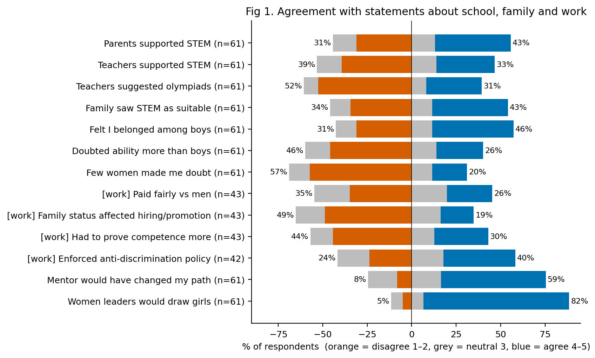
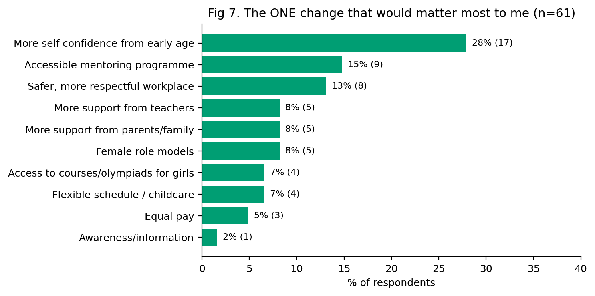

# Women in STEM and IT in Kyrgyzstan

**Code, aggregate results and figures** for the independent research project
*Factors Associated with Girls' and Women's Participation in STEM and IT in Kyrgyzstan: A Survey of 61 Respondents*
by Datkaiym Zhamalidinova (2026).

The project is based on an online survey (Google Forms, n = 61) of schoolgirls and women in Kyrgyzstan. It asks three things: what in school and family is associated with girls entering STEM, what women experience at work, and which measures respondents believe would help most.



---

## Key findings

All results are associations in a small, self-selected sample, not causal effects (see [Limitations](#limitations)).

**RQ1 – School and family.** About a third of respondents attended a STEM class (36%) or took part in a STEM olympiad (34%), and 38% of adults studied a STEM field. Of the 39 factor tests, 7 remain significant after Holm correction, and all of them concern olympiad participation or a STEM field of study:

| Outcome | Factor | Result | p (Holm) |
|---|---|---|---|
| STEM olympiad | Teachers suggested olympiads | median 4 vs 1.5, r = 0.64 | .001 |
| STEM olympiad | Teachers supported STEM | median 5 vs 2, r = 0.60 | .003 |
| STEM olympiad | Felt I belonged among boys | median 5 vs 3, r = 0.57 | .007 |
| STEM olympiad | Had a mentor | 67% vs 21%, OR ≈ 7.0 | .037 |
| STEM olympiad | Parents supported STEM | median 5 vs 3, r = 0.49 | .044 |
| STEM field of study (adults) | Teachers supported STEM | median 4 vs 2, r = 0.58 | .026 |
| STEM field of study (adults) | Felt I belonged among boys | median 5 vs 3, r = 0.55 | .038 |

The most common reasons for not taking part were *no interest at the time* (37%) and *did not know it existed* (35%); 17% said there was no access in their region.

**RQ2 – Work.** Among the 15 respondents working in IT/STEM, 9 of 14 were asked about marriage or children at a job interview, and 8 of 14 felt their technical skills were underestimated.

**RQ3 – What would help.** The most frequently chosen measures were leadership and confidence programmes (61%), equal and transparent pay (56%) and flexible schedules or childcare support (56%). Asked for the *one* change that would matter most, the top answer was more self-confidence from an early age (28%).



---

## Research questions

| RQ | Question | Result sheets | Figures |
|---|---|---|---|
| RQ1 | Which school and family factors (parental and teacher support, role models, mentors, sense of belonging, place of childhood) are associated with attending a STEM class, taking part in an olympiad and choosing a STEM field of study? | 3–10 | 1–4 |
| RQ2 | What do women experience at work (interview questions about family, maternity leave, pay, behaviour of male colleagues)? | 11–13 | 5 |
| RQ3 | Which measures do respondents consider most effective? | 14–15 | 6–7 |

## Repository contents

```
.
├── analysis.py                 # the whole pipeline: cleaning → codebook → tests → tables → figures
├── data/
│   └── codebook.csv            # every variable: original question (Russian), type, coding
├── results/
│   ├── results_tables.xlsx     # 16 result sheets + a README sheet explaining each test
│   └── run_log.txt             # row counts, parsing notes, software versions
├── figures/                    # figures 1–7 (PNG)
├── requirements.txt
├── LICENSE                     # MIT (code)
└── LICENSE-CC-BY-4.0.md        # CC BY 4.0 (figures, tables, codebook, docs)
```

| Figure | Content |
|---|---|
| [Fig 1](figures/fig1_likert_overview.png) | Agreement with statements about school, family and work |
| [Fig 2](figures/fig2_outcomes_by_support.png) | Olympiad participation and STEM study by support and belonging |
| [Fig 3](figures/fig3_reasons_not_taking_part.png) | Reasons for not taking part in STEM classes or olympiads |
| [Fig 4](figures/fig4_mentor_role_model.png) | Mentors and female role models |
| [Fig 5](figures/fig5_workplace_behaviour.png) | Behaviour of colleagues at work |
| [Fig 6](figures/fig6_rq3_top3_measures.png) | Top-3 measures chosen by respondents |
| [Fig 7](figures/fig7_rq3_one_change.png) | The one change that would matter most |

## How to reproduce

Requires Python 3.10 or newer. The published results were produced with Python 3.12, pandas 3.0 and scipy 1.17 (see `results/run_log.txt`).

```bash
python -m venv .venv
source .venv/bin/activate          # Windows: .venv\Scripts\activate
pip install -r requirements.txt
python analysis.py path/to/raw_google_forms_export.xlsx [output_dir]
```

`output_dir` is optional and defaults to the folder containing `analysis.py`. The script (re)creates `data/`, `results/` and `figures/` inside it and writes:

| File | Public? |
|---|---|
| `results/results_tables.xlsx`, `results/run_log.txt`, `figures/*.png` | yes |
| `data/survey_clean_anonymized.xlsx` – cleaned respondent-level data | no, excluded by `.gitignore` |
| `data/specialty_coding.csv` – STEM / non-STEM coding of specialties | no, excluded by `.gitignore` |

Manual STEM codes entered in the `manual_code` column of `data/specialty_coding.csv` override the automatic codes and are kept between runs.

The raw export is not included, so the analysis can only be re-run with access to the data (see below).

## Data availability

The repository contains **no respondent-level data**: only the code, the codebook, aggregate results tables and figures. Participants were promised confidentiality, the raw export contains contact details, free-text answers could identify people, and some respondents are under 18. For these reasons the anonymised dataset is not published.

It is available from the author on reasonable request for research purposes. <!-- TODO: contact -->

## Methods

- **Likert items** use a five-point scale (1 = strongly disagree … 5 = strongly agree) and are treated as ordinal: medians and % agree (4–5) / disagree (1–2) are reported.
- **Group comparisons:** Mann–Whitney U with rank-biserial r for Likert factors; Fisher's exact test with Haldane-corrected odds ratios for binary factors.
- **Multiple testing:** Holm correction across the 39 tests in sheet 5 (Holm, 1979). Sheet 6 repeats the tests for adults only as a robustness check.
- **Correlations:** Spearman's rho between Likert items (Sullivan & Artino, 2013).
- **Scale reliability:** Cronbach's alpha for candidate scales (Tavakol & Dennick, 2011). The support scale is reliable (α = 0.86); the insecurity scale is not (α = 0.30), so its items are analysed separately.
- **STEM field of study** is coded from free-text answers with a keyword list (`KW` in `analysis.py`); ambiguous answers are flagged for manual review. Only adults who stated a field are included (n = 47).
- **"Not applicable"** answers are treated as missing, and every percentage states its denominator.
- **Top-3 measures:** 15 respondents selected more than three options; their answers are kept as given.
- **Open-ended answers** were analysed separately with reflexive thematic analysis (Braun & Clarke, 2006) and are not part of this code.

## Limitations

- Non-random, self-selected sample (n = 61); results describe the respondents, not all women in Kyrgyzstan.
- Small subgroups: 15 IT/STEM workers, 10 respondents with a female role model, 18 with a mentor.
- Retrospective self-report, and the same items were answered by schoolgirls and adults.
- Results are associations, not causal effects, and some may run in the opposite direction (for example, olympiad success may increase a sense of belonging rather than the other way round).
- Views on which measures work (RQ3) reflect respondents' opinions, not evidence of effect.

## License

- Code (`analysis.py`): [MIT](LICENSE)
- Figures, results tables, codebook and documentation: [CC BY 4.0](LICENSE-CC-BY-4.0.md)

## Citation

If you use this material, please cite:

> Zhamalidinova, D. (2026). *Factors Associated with Girls' and Women's Participation in STEM and IT in Kyrgyzstan: A Survey of 61 Respondents.* High school research project. GitHub repository.

```bibtex
@misc{zhamalidinova2026stem,
  author = {Zhamalidinova, Datkaiym},
  title  = {Factors Associated with Girls' and Women's Participation in STEM and IT in Kyrgyzstan: A Survey of 61 Respondents},
  year   = {2026},
  note   = {High school research project, GitHub repository}
}
```
